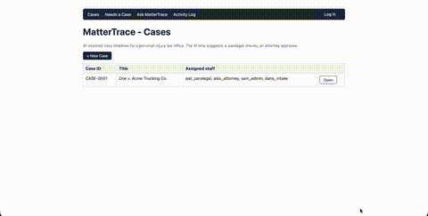

# MatterTrace

MatterTrace is a CEN 4010 final project prototype for a personal-injury law office. Records arrive from different sources, and staff need to know where each timeline entry came from and who checked it. MatterTrace suggests entries from sample text, flags possible conflicts, and lets staff review the timeline before the assigned attorney approves it.

- [GitHub repository](https://github.com/YourAznGurl/cen4010-final-project)
- [MatterTrace PDF](https://github.com/YourAznGurl/cen4010-final-project/blob/main/MatterTrace.pdf)
- [Final Presentation](./MatterTrace%20_%20CEN%204010%20Final%20Presentation.pdf)

## Demo



## Run locally

From the project folder, use Python 3.10 or newer:

```bash
python3 -m venv .venv
source .venv/bin/activate
python -m pip install -r requirements.txt
python -m app.main
```

On Windows PowerShell, activate the environment with `.\.venv\Scripts\Activate.ps1` after creating it.

Open [MatterTrace](http://127.0.0.1:5000). The synthetic case **Doe v. Acme Trucking Co.** loads automatically. Restarting the app resets the case.

## Try the approval workflow

1. Log in as `dana_intake` and click **Needs a Case** to see the unassigned fax.
2. Log out and log in as `pat_paralegal`. Click **Cases → Open**. Look for the duplicate, unreadable documents, and missing-record notices.
3. Click **Approve** on the client's **$1,200** statement. It moves to **Checked entries**. Click **Approve** on a **Mismatch or unclear** suggestion to send it to the attorney queue. Review the remaining suggestions.
4. Log out and log in as `alex_attorney`. Open the case and click **Approve Timeline** before resolving the queue. The timeline stays Draft.
5. Open **Attorney Queue** and resolve each synthetic item. Return to the case and click **Approve Timeline → Export Timeline**. After the queue is clear and every included entry is checked, the export shows **Approved by attorney**.

**Ask MatterTrace** directs users to an attorney when it recognizes a legal-advice request. It gives a general scope reply to other questions. The **Activity Log** shows recorded actions and their details when available.

## How it works

MatterTrace follows the course's **Document Intelligence** architecture in one Flask app.

| Course element | What MatterTrace uses |
| --- | --- |
| API / CLI Ingestion | Flask form for pasted text and case assignment |
| Document Store | In-memory text and document metadata |
| GenAI Extraction Service | Fixed rules in `app/extraction.py` |
| Knowledge / Fact Store | In-memory timeline entries, source IDs, source sentences, and review status |
| Human Review Workbench | Review page for checking, correcting, rejecting, or escalating suggestions |
| GenAI Report Service | HTML timeline export with review labels and source IDs |
| Authorized Reviewer / Decision Maker | Assigned attorney who resolves queued items and approves the timeline |

The extractor proposes entries. Staff make review decisions. Processing new eligible evidence or changing an entry's review clears the prior timeline approval.

## Testing

```bash
python -m pytest -q tests
```

All **33 tests** passed locally after the approval fix. The suite mainly checks store and extraction rules. A separate browser check showed that six unchecked entries blocked approval even with an empty queue. After all six were checked and the queue was clear, the attorney approved the timeline and the export displayed the approved status.

## Limits and AI assistance

- The demo uses synthetic text, a role picker, and in-memory storage. Use synthetic data. The app makes no external model calls.
- The export displays source IDs. Clickable source navigation is future work.
- Mismatch detection compares amounts on the same date string. Reopening individual entries when new evidence contradicts them remains future work.
- Extraction accuracy, timing, and label comprehension have yet to be formally measured. The project uses the instructor's law-office scenario. No stakeholder interviews were conducted.

Claude helped draft the architecture, code, tests, and documentation. ChatGPT helped audit the code, verify the approval behavior, and revise the project materials. The Solution Design Report explains the results and remaining limitations.
